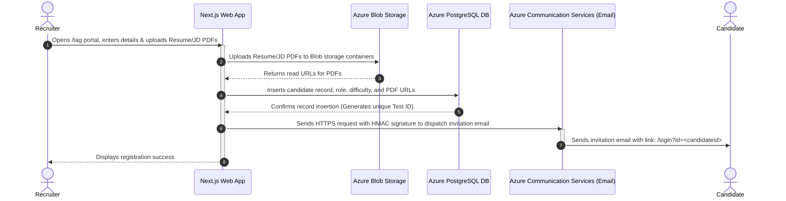
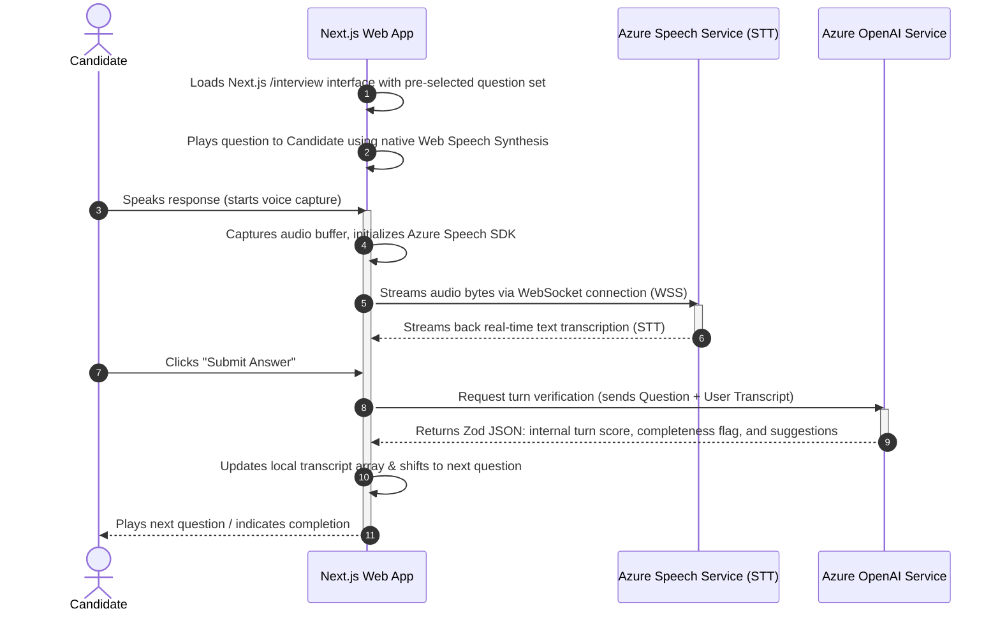
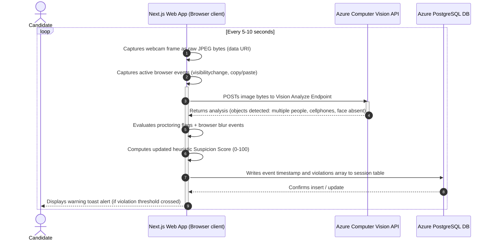
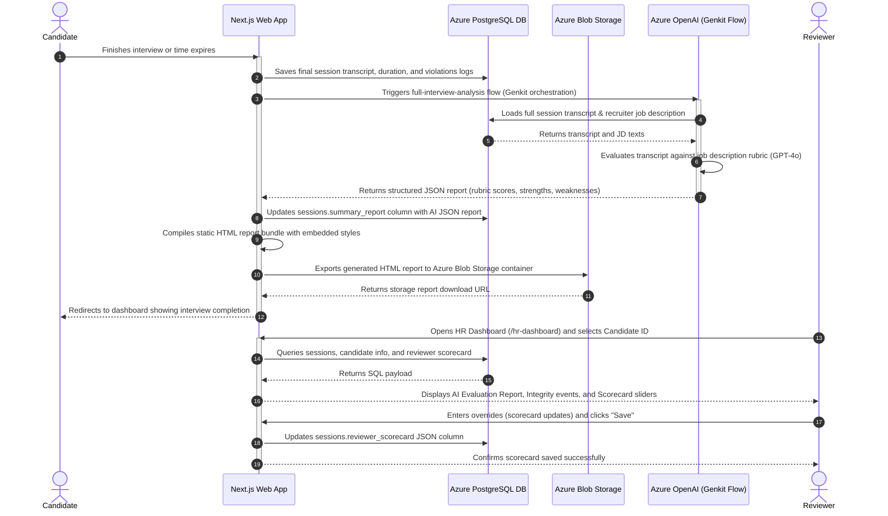
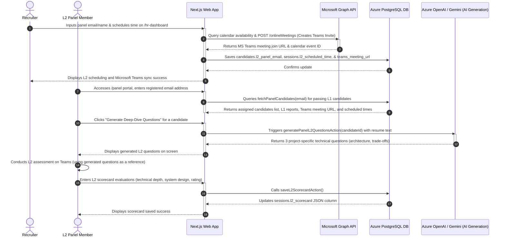

# System Architecture & Cloud Migration Blueprint (ProPrep AI)

This document provides a detailed technical architecture and cloud services blueprint for **ProPrep AI** (AI Interview & Proctoring Platform). It outlines the target infrastructure following the migration from **Render** to **Azure App Service** and from **Retool Database** to **Azure Database for PostgreSQL (Flexible Server)**, as well as detailing all external integrations, tech stacks, and data flows.

---

## 1. Executive Architecture Summary

ProPrep AI is designed as a unified **Next.js 15 App Router** application that leverages a monolithic deployment pattern to streamline hosting, state synchronization, and operational maintenance. 

The application utilizes **React Server Components (RSC)** for data fetching and server actions as its API boundary, eliminating the need for a separate backend API server. AI orchestration is managed through **Genkit**, which acts as a structured middleware interfacing with **Azure OpenAI** and **Google Gemini**. Persistent application state is stored in a relational PostgreSQL database, while heavy binary files (video streams, resumes, reports) are stored in block and append-based object storage.

### High-Level Architecture Overview

```
                          +-------------------------------------------------+
                          |                  Client Browser                 |
                          | (React UI / Speech-to-Text SDK / Webcam Capture)|
                          +------------------------+------------------------+
                                                   |
                                                   | Inbound HTTPS / WSS
                                                   v
+--------------------------------------------------+-------------------------------------------------+
|                                Azure Virtual Network (VNet) Security Boundary                      |
|                                                                                                    |
|   +--------------------------------------------------------------------------------------------+   |
|   |                          Azure App Service (Linux / Node.js 20 Runtime)                    |   |
|   |                          Hosts Next.js Frontend UI & Backend Server Actions                |   |
|   +----+--------------------------+-----------------------+---------------------+----------+---+   |
|        |                          |                       |                     |          |       |
|        | TCP/5432 (TLS)           | HTTPS (REST API)      | HTTPS (REST API)    | HTTPS    | HTTPS |
|        v                          v                       v                     v          v       |
|   +----+--------------------+ +---+-----------------+ +---+---------------+  +--+-------+  |       |
|   |  Azure Database for     | | Azure Cognitive     | | Azure Storage     |  | Azure    |  |       |
|   |  PostgreSQL             | | Services            | | Account           |  | Open-AI  |  |       |
|   |  (Flexible Server)      | | - Speech (STT)      | | (Blob Storage)    |  | Service  |  |       |
|   |                         | | - Vision (Proctor)  | | - Audio/Video webm|  | (Primary |  |       |
|   |  Stores:                | | [DISABLED/NOT USED] | | - Resumes & JDs   |  | LLM/AI)  |  |       |
|   |  - Candidate metadata   | | - Doc Intelligence  | | - HTML exports    |  +----------+  |       |
|   |  - Sessions & scores    | | - Face API          | +-------------------+                |       |
|   |  - Proctoring logs      | +---------------------+                                      |       |
|   |  - L2 Panel scorecards  |            |                                                 |       |
|   +-------------------------+            | HTTPS (REST API)                                |
|                                          v                                                 |
|                               +----------+----------+                                      |
|                               | Microsoft Graph API |                                      |
|                               | (Teams Calendar &   | <------------------------------------+
|                               |  Online Meetings)   |
|                               +---------------------+
|                                                                                            v       |
|                                                                                      +-----+-----+ |
|                                                                                      | Google AI | |
|                                                                                      | (Gemini   | |
|                                                                                      | Fallback) | |
|                                                                                      +-----------+ |
+----------------------------------------------------------------------------------------------------+
```

---

## 2. Infrastructure Migration Strategy

To support enterprise readiness, high availability, and compliance requirements, the application's infrastructure is migrating from a mixed provider setup to a standardized, single-cloud architecture on Microsoft Azure.

### 2.1 App Hosting: Render to Azure App Service

*   **Former State (Render)**: Hosted as a Render Web Service running Next.js. While simple, it lacked native virtual private network (VNet) integration, enterprise-grade access control, and region-locked routing, and suffered from unpredictable egress bandwidth costs.
*   **Target State (Azure App Service - Linux)**: The Next.js 15 build is hosted on a Linux App Service Plan (recommended standard tier `S1` or premium `P1v3` for production).
*   **Benefits**:
    *   **VNet Integration**: Secures all backend traffic (Database, Storage, Cognitive services) through private endpoints.
    *   **Managed Identities**: Passwordless authentication to Azure services, eliminating the threat of credentials leak in configuration files.
    *   **Scaling Policy**: Horizontal auto-scaling based on CPU utilization or request queue length during peak recruitment seasons.
    *   **Integrated Monitoring**: Full metrics reporting, logs integration with Azure Monitor, and Application Insights tracking client/server telemetry.

### 2.2 Database: Retool Database to Azure Database for PostgreSQL (Flexible Server)

*   **Former State (Retool Database)**: A shared database instance hosted on Retool's cloud PostgreSQL. This setup is restricted by small connection pools, lack of zone redundancy, lack of database tuning capabilities, and exposure to public internet connections.
*   **Target State (Azure Database for PostgreSQL - Flexible Server)**: Migrating to a fully managed PostgreSQL instance (v15 or v16) deployed inside the VNet.
*   **Benefits**:
    *   **High Availability**: Zone-redundant configurations with synchronous replication.
    *   **Connection Management**: Built-in PgBouncer connection pooling to efficiently manage concurrent Next.js Server Actions connections.
    *   **Security**: IP Firewall restrictions, private access via virtual networks, and enforced SSL/TLS v1.2/1.3 connections.
    *   **Point-in-Time Restore (PITR)**: Automatic daily backups with configurable retention up to 35 days.

---

## 3. Technology Stack Reference & Matrix

The following matrix maps every technology, driver, and API used in the application.

> [!IMPORTANT]
> **Aadhar / ID Verification Bypass**: The Aadhar Verification flow (`/verify-aadhar` route) and Azure Document Intelligence integrations are **currently disabled and not in use**. They have been bypassed in the active candidate flow. The candidate proceeds directly from the unique invitation login link to the interview setup dashboard.

| Architecture Layer | Component / Tool | Technology / Service Provider | SDK / Library (package.json) | Primary Config Variables | Integration Protocol | Fallback / Graceful Degradation Strategy |
| :--- | :--- | :--- | :--- | :--- | :--- | :--- |
| **Application Framework** | Next.js 15.3.8 | Vercel / Node.js Runtime | `next`, `react`, `react-dom` | `PORT`, `NEXT_PUBLIC_APP_URL` | HTTP/HTTPS (Web Client) | N/A (Core runtime) |
| **Database Server** | PostgreSQL 16 | Azure Database for PostgreSQL | `pg` (v8.20.0), `node-pg-migrate` | `DATABASE_URL` | TCP/5432 with TLS (rejectUnauthorized: false) | Throws connection error on bootstrap. |
| **AI Orchestration** | Genkit | Google AI Genkit Framework | `genkit`, `@genkit-ai/next` | N/A | TypeScript Flow Execution | N/A (Core orchestrator) |
| **Primary AI Provider** | Azure OpenAI | Microsoft Azure | Local adapter (`src/lib/azure-openai.ts`) | `AZURE_OPENAI_API_KEY`, `AZURE_OPENAI_ENDPOINT`, `AZURE_OPENAI_DEPLOYMENT` | HTTPS REST (Zod validation schemas) | Falls back to Google Gemini if AI endpoint or key is unavailable. |
| **Secondary AI Provider** | Gemini API | Google AI | `@genkit-ai/googleai` | `GEMINI_API_KEY` (or `GOOGLE_GENAI_API_KEY`) | HTTPS REST (Zod validation schemas) | Graceful fallback if Azure is primary and fails; returns diagnostic error if both are down. |
| **Speech-to-Text (STT)** | Azure Speech | Azure Cognitive Speech Service | `microsoft-cognitiveservices-speech-sdk` | `AZURE_SPEECH_KEY`, `AZURE_SPEECH_REGION` | WebSocket (WSS) via dynamic browser token auth | STT capability is disabled; client UI falls back to manual keyboard input. |
| **Text-to-Speech (TTS)** | Native Web Speech | Browser SpeechSynthesis API | Browser Native (`window.speechSynthesis`) | N/A | Client browser execution (zero-cost API) | Client audio playback disabled (text-only prompt shown). |
| **Webcam Proctoring** | Azure Computer Vision | Azure AI Vision (Image Analysis) | `@azure-rest/ai-vision-image-analysis` | `AZURE_VISION_ENDPOINT`, `AZURE_VISION_KEY` | HTTPS REST | Proctoring warnings bypassed; logs "proctoring inactive" (dev convenience). |
| **Face Analysis (Disabled)** | Azure Face API | Azure Face Service | Local request helper | `AZURE_FACE_ENDPOINT`, `AZURE_FACE_KEY` | HTTPS REST | **Disabled / Not in active use.** |
| **ID Verification (Disabled)**| Azure Doc Intelligence | Azure AI Document Intelligence | `@azure/ai-form-recognizer` | `AZURE_DOCUMENT_INTELLIGENCE_ENDPOINT`, `AZURE_DOCUMENT_INTELLIGENCE_KEY` | HTTPS REST | **Disabled / Not in active use.** The application bypasses the identity check. |
| **File & Video Storage** | Azure Blob Storage | Azure Storage Account | `@azure/storage-blob` | `AZURE_STORAGE_CONNECTION_STRING` or `AZURE_STORAGE_SAS_URL` | HTTPS REST | Recording chunks and exports logged as success but discarded (mock-mode). |
| **Email Service** | Azure Communication Services | Azure ACS (Email Resource) | REST API via local dynamic authorization helper | `AZURE_COMMUNICATION_EMAIL_CONNECTION_STRING`, `AZURE_COMMUNICATION_EMAIL_SENDER` | HTTPS REST (HMAC-SHA256 signature headers) | Invitation logged in console; registration completes without sending actual email. |
| **Teams & Calendar Integration** | Microsoft Graph API | Microsoft 365 (Microsoft Entra ID) | Local HTTPS Client Wrapper (`@microsoft/microsoft-graph-client` optional) | `MICROSOFT_CLIENT_ID`, `MICROSOFT_CLIENT_SECRET`, `MICROSOFT_TENANT_ID` | HTTPS REST | Calendar Sync falls back to DB scheduling values; meeting link generated locally or via Outlook. |

---

## 4. End-to-End Core Operational Flows

The following sequences illustrate how data and network requests flow through the target Azure infrastructure.

### 4.1 Candidate Registration & Onboarding Flow
This flow initiates when a recruiter registers a candidate for a role.



### 4.2 Candidate Verification & Identity Checks (DISABLED / NOT IN USE)
This flow is currently disabled in the system. The application has bypassed these operations, routing candidates directly to the dashboard launch stage without verifying document snapshots.

```
+-------------------+      Redirect      +----------------------+
|  Candidate Opens  | -----------------> | Candidate Dashboard  |
|  /login?id=...    |                    |  /start & /interview |
+-------------------+                    +----------------------+
          |                                         ^
          |                                         |
          +---------- [ Aadhar Verify Bypassed ] ---+
```

### 4.3 AI-Enabled Interview Turn (Deterministic Loop)
A deterministic turn-based loop where questions are fetched from a local bank or candidate resume, user response is recorded via STT, and results are fed back into local state.



### 4.4 Proctoring and Security Tracking
Real-time tracking of browser window events and webcam proctoring frames.



### 4.5 Interview Completion & Review Evaluation
The post-interview debrief where the final AI report is compiled, stored, exported, and reviewed by HR.



### 4.6 L2 Technical Panel Assessment & Teams Meeting Integration Flow
For candidates whose AI Interview yields a positive recommendation (`Strong Hire`, `Hire`, or `Leaning Hire`), recruiters schedule them for an L2 technical assessment panel. Recruiters assign the candidate and generate a Teams online meeting URL through the Microsoft Graph API. L2 panel members use a dedicated portal (`/panel`) to check schedules, generate AI-tailored project questions, and log scorecards.



---

## 5. Relational Database Schema Design

The application's relational data structure is defined by three key tables: `candidates`, `sessions`, and `violation_events`. This relational schema is executed and maintained in production using `node-pg-migrate` files located in the `migrations/` directory.

### 5.1 Candidates Table (`candidates`)
Stores recruiter-entered profile data, resume/JD information, and assigned L2 Panel details.

| Column Name | Data Type | Modifiers / Default | Description |
| :--- | :--- | :--- | :--- |
| `id` | `TEXT` | `PRIMARY KEY` | Unique identifier (e.g. `cand-se-001`) |
| `name` | `TEXT` | `NULL` | Candidate's full name |
| `email` | `TEXT` | `NULL` | Candidate's email address |
| `role` | `TEXT` | `NOT NULL` | Registered target job title |
| `difficulty` | `TEXT` | `NOT NULL` | Interview difficulty: `easy`, `medium`, `hard` |
| `topics` | `JSONB` | `DEFAULT '[]'` | Specific topic areas parsed or selected for the test |
| `resume_url` | `TEXT` | `NULL` | Azure Blob URL for candidate's uploaded resume |
| `resume_file_name` | `TEXT` | `NULL` | Original filename of the resume PDF |
| `job_description_url` | `TEXT` | `NULL` | Azure Blob URL for recruiter's uploaded JD |
| `job_description_file_name` | `TEXT` | `NULL` | Original filename of the Job Description PDF |
| `resume_text` | `TEXT` | `NULL` | Raw extracted text from resume PDF |
| `job_description_text` | `TEXT` | `NULL` | Raw extracted text from JD PDF |
| `question_bank` | `TEXT` | `NULL` | Custom pasted question text override |
| `l2_panel_name` | `TEXT` | `NULL` | Assigned L2 Technical Panel member name |
| `l2_panel_email` | `TEXT` | `NULL` | Assigned L2 Technical Panel email address (primary query filter) |
| `selfie_url` | `TEXT` | `NULL` | [DISABLED/NOT USED] Azure Blob URL for verification selfie |
| `selfie_blob_name` | `TEXT` | `NULL` | [DISABLED/NOT USED] Unique filename stored in storage container |
| `selfie_captured_at` | `TIMESTAMPTZ` | `NULL` | [DISABLED/NOT USED] Used to log timestamp selfie was taken |
| `created_at` | `TIMESTAMPTZ` | `DEFAULT CURRENT_TIMESTAMP` | Time candidate record was created |

### 5.2 Sessions Table (`sessions`)
Tracks the active AI interview session, scoring, proctoring events, and L2 Panel scorecard logs.

| Column Name | Data Type | Modifiers / Default | Description |
| :--- | :--- | :--- | :--- |
| `id` | `TEXT` | `PRIMARY KEY` | Unique session ID (e.g. `session-abc-123`) |
| `candidate_id` | `TEXT` | `REFERENCES candidates(id)` | Foreign key link to candidate profile |
| `date` | `TIMESTAMPTZ` | `DEFAULT CURRENT_TIMESTAMP` | Start timestamp of AI interview |
| `role` | `TEXT` | `NOT NULL` | Interview job role |
| `score` | `INT` | `DEFAULT 0` | Candidate performance score generated by AI |
| `duration` | `TEXT` | `NULL` | Text string representing interview duration (e.g. `"15m 32s"`) |
| `feedback` | `JSONB` | `DEFAULT '[]'` | Array containing per-turn internal coaching suggestions |
| `transcript` | `JSONB` | `DEFAULT '[]'` | Complete conversational array (Role, Question, Answer) |
| `summary_report` | `JSONB` | `NULL` | Final AI evaluation report (JSON schema object) |
| `violations` | `JSONB` | `DEFAULT '[]'` | Inline collection of proctoring events with timestamps |
| `security_events` | `JSONB` | `DEFAULT '[]'` | Raw browser focus, copy, paste events |
| `suspicion_score` | `INT` | `DEFAULT 0` | Aggregated proctoring security rating (0 to 100) |
| `reviewer_scorecard` | `JSONB` | `NULL` | Editable fields submitted by HR reviewer (L1 evaluation) |
| `l2_scorecard` | `JSONB` | `DEFAULT '{}'` | Structured evaluation scorecard completed by L2 panel member |
| `l2_scheduled_time` | `TIMESTAMPTZ` | `NULL` | Date and time scheduled for L2 panel evaluation |
| `teams_meeting_url` | `TEXT` | `NULL` | Microsoft Teams Online Meeting Join URL generated by Microsoft Graph |
| `identity_status` | `TEXT` | `NULL` | [DISABLED/NOT USED] Identity match state |
| `identity_score` | `NUMERIC` | `NULL` | [DISABLED/NOT USED] Fuzzy-match score output from ID lookup |
| `identity_verified_at`| `TIMESTAMPTZ` | `NULL` | [DISABLED/NOT USED] Timestamp of identity matching |
| `identity_error` | `TEXT` | `NULL` | [DISABLED/NOT USED] Diagnostic log if ID verification fails |

### 5.3 Violation Events Table (`violation_events`)
Optimized for storage audits and compliance policies; holds isolated proctoring frame alerts.

| Column Name | Data Type | Modifiers / Default | Description |
| :--- | :--- | :--- | :--- |
| `id` | `TEXT` | `PRIMARY KEY` | Violation ID |
| `session_id` | `TEXT` | `REFERENCES sessions(id) ON DELETE CASCADE` | Link to session |
| `event_ts` | `TIMESTAMPTZ` | `DEFAULT CURRENT_TIMESTAMP` | Precise timestamp of the event |
| `event_type` | `TEXT` | `NULL` | Alert type: `MULTIPLE_PEOPLE`, `PHONE_DETECTED`, `FACE_ABSENT` |
| `image_url` | `TEXT` | `NULL` | Reference to proctoring webcam frame snapshot in Azure Blob |
| `metadata` | `JSONB` | `DEFAULT '{}'` | Additional details returned from Azure Computer Vision |

---

## 6. Security, Compliance & Secrets Management

Moving to Azure enables strict enterprise-grade security controls.

### 6.1 Database Security with TLS
*   **Enforced SSL**: Direct connections to Azure Database for PostgreSQL require SSL/TLS to prevent eavesdropping. The database connection pool inside [src/lib/db.ts](file:///c:/Surya/Interview-prep-1/src/lib/db.ts) sets:
    ```typescript
    ssl: { rejectUnauthorized: false }
    ```
    This allows secure connections using public authority certificates. For advanced environments, the CA certificate file `DigiCertGlobalRootG2.crt.pem` should be bundled and loaded explicitly to validate the certificate chain (`rejectUnauthorized: true`).

### 6.2 App Service Secrets Integration
To prevent sensitive keys from leaking into version control:
*   **Application Settings**: Move secrets from local `.env` files to Azure App Service **Application Settings** (Configuration -> Application Settings). Azure decrypts these values at runtime and injects them as standard environment variables.
*   **Azure Key Vault**: Critical keys (e.g. `AZURE_OPENAI_API_KEY`, `DATABASE_URL`) should be stored in Azure Key Vault. Access is granted to the App Service using **System-Assigned Managed Identity**. The App Settings refer to the Key Vault secrets using Key Vault references:
    ```text
    @Microsoft.KeyVault(SecretUri=https://<vault-name>.vault.azure.net/secrets/<secret-name>/)
    ```
*   **Microsoft Entra ID (M365 Integration Credentials)**: Client ID, Secret, and Tenant ID (`MICROSOFT_CLIENT_ID`, `MICROSOFT_CLIENT_SECRET`, `MICROSOFT_TENANT_ID`) required for Microsoft Graph authorization are also managed as Key Vault references.

### 6.3 Network Isolation
*   **Virtual Network (VNet) Integration**: By enabling outbound VNet integration on the Next.js App Service, all outbound TCP traffic is routed through a private subnet.
*   **Private Endpoints**: Disable public internet access on the Azure PostgreSQL instance and Storage Account. Enable Private Endpoints so that the App Service communicates with these services via private, non-routable IP addresses (e.g. `10.0.1.x`) within the VNet.

---

## 7. Next Steps for Azure Deployment

To execute the deployment to this target architecture:
1.  **Provision Azure Resources**: Set up an Azure App Service (Linux B1/S1 plan), Azure Database for PostgreSQL (Flexible Server), Azure Blob Storage, Azure Cognitive Services (Speech, Vision), Azure OpenAI, and configure an Azure AD Application Registration for Microsoft Graph.
2.  **Configure App Settings**: Add the required database connection strings, Azure endpoint configurations, MS Graph client secrets, and api keys into the App Service environment.
3.  **Execute Migrations**: Run the database migration script (`npm run migrate:up`) to bootstrap tables in the new PostgreSQL instance prior to launching the Next.js application.
4.  **Continuous Deployment (CI/CD)**: Bind the project repository using GitHub Actions or Azure Pipelines targeting the App Service deployment endpoint.
